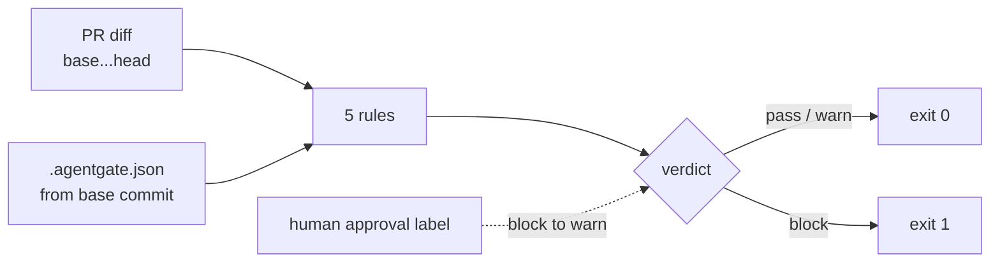

# agentgate

Block AI-agent PRs that weaken tests, edit guardrails, or escalate CI permissions.

Semgrep and gitleaks catch insecure code. They do not catch a PR that deletes the failing test, loosens the workflow permissions, or silences the scanner. agentgate checks that layer: it reads the PR diff, applies five rules, and fails the check when the change needs a human.

## How it works



Details, trust boundaries and the override flow: [docs/architecture.md](docs/architecture.md).

## Rules

| Rule | Blocks when | Default |
| --- | --- | --- |
| `test-weakened` | a test file is deleted, moved out of test paths, or changed as binary, a test is skipped or focused, or the PR removes more assertions than it adds | block |
| `guardrail-edited` | the PR touches `.github/**`, `CODEOWNERS`, `AGENTS.md`, `.agentgate.json`, scanner configs, or paths you add | block |
| `workflow-escalation` | a workflow gains `pull_request_target`, `write-all`, a `write` permission, a secret, untrusted `github.event` interpolation, or an action not pinned to a full commit SHA | block |
| `dependency-added` | `package.json` or `requirements*.txt` gains a dependency, or an install lifecycle script changes | warn |
| `suppression-added` | a changed line silences a scanner or the type checker (`nosemgrep`, `eslint-disable`, `@ts-ignore`, `noqa`, `NOSONAR`, ...) | warn |

## Quick start

```yaml
# .github/workflows/agentgate.yml
on:
  pull_request:
    types: [opened, synchronize, reopened, labeled, unlabeled]
permissions:
  contents: read
  pull-requests: read
jobs:
  gate:
    name: agentgate
    runs-on: ubuntu-latest
    steps:
      - uses: actions/checkout@3d3c42e5aac5ba805825da76410c181273ba90b1 # v7.0.1
        with:
          fetch-depth: 0
      - uses: piyush97/agentgate@13e7fc870ea5ebd2df2166efe9b2118e950a85f4 # v0.1.0
```

`fetch-depth: 0` is required: the Action resolves the PR base commit to read config and file contents from it.

From this checkout, against the last three commits:

```bash
node dist/cli.js check --base HEAD~3
```

## Config

`.agentgate.json` at the repository root. It is read from the PR **base** commit, so a PR cannot turn rules off in the same change that violates them.

```json
{
  "testGlobs": ["**/*.test.*", "**/*.spec.*", "**/__tests__/**", "**/test/**", "**/tests/**", "**/*_test.go", "**/test_*.py", "**/*_test.py"],
  "protectedPaths": [".github/**", "**/CODEOWNERS", ".agentgate.json", "**/AGENTS.md", "**/CLAUDE.md", ".cursor/**", ".semgrepignore", ".semgrep.yml", ".gitleaks.toml", ".gitleaksignore", "**/.npmrc"],
  "overrideLabel": "agentgate-approved",
  "rules": {
    "test-weakened": "block",
    "guardrail-edited": "block",
    "workflow-escalation": "block",
    "dependency-added": "warn",
    "suppression-added": "warn"
  }
}
```

- `protectedPaths` is **append-only**: your entries are added to the defaults. You cannot drop `.agentgate.json` or `.github/**`.
- `testGlobs` and `overrideLabel` replace the defaults.
- `rules` merges per rule; values are `block`, `warn`, or `off`.
- Unknown keys, unknown rules, and bad severities fail the run with exit 2 instead of being ignored.

## Override

A reviewer who has read the change can apply the `agentgate-approved` label. The block becomes a warning, and the step summary names who approved it.

The label only counts when:

- this run was triggered by applying the approval label (`labeled`),
- the latest `labeled` or `unlabeled` event for it is a `labeled` event,
- the actor is a user account, not a bot,
- the actor is not the PR author.

Remove and re-apply the label after new commits, reopening the PR, or another label event. Existing labels never approve these runs. API errors or incomplete event history also keep the block.

Anything else keeps the block and says why in the summary. The Action has `contents: read` and `pull-requests: read`; it never writes to the PR.

## Required setup

Make the `agentgate` job a required status check in branch protection. Add `.github/** @your-owner` to CODEOWNERS and enable **Require review from Code Owners**. A PR can otherwise replace or remove the workflow that runs the gate. For organizations with ruleset-required workflows, run the gate from that trusted workflow.

The pre-release self-gate uses `./`, which runs the PR's own `dist/`. CODEOWNERS review is essential. After v0.1.0, pin the self-gate to the released full commit SHA. Pin consumers to a full SHA too: mutable version tags fail `workflow-escalation`.

## Exit codes

| Code | Meaning |
| --- | --- |
| 0 | pass or warn |
| 1 | block |
| 2 | usage or environment error (missing base commit, bad config) |

Exit 2 is deliberate: a shallow clone fails loudly instead of passing.

## What it does not catch

This gate reads diffs, not behavior. It cannot see authorization bugs, IDOR, tenant isolation breaks, or business-logic errors, and an agent that writes a plausible test for wrong behavior passes every rule here. Keep SAST, secret scanning, and human review of the risky paths.

Background and the threat model: [AI Coding Agents Pass Tests, Ship Insecure Code](https://piyushmehta.com/blog/ai-coding-agent-security-gate).

## Development

```bash
npm ci
npm test
npm run typecheck
npm run build   # dist/ is committed for the Action; CI fails on stale dist/
```

See [CONTRIBUTING.md](CONTRIBUTING.md). Report bypasses privately per [SECURITY.md](SECURITY.md).

MIT licensed.
