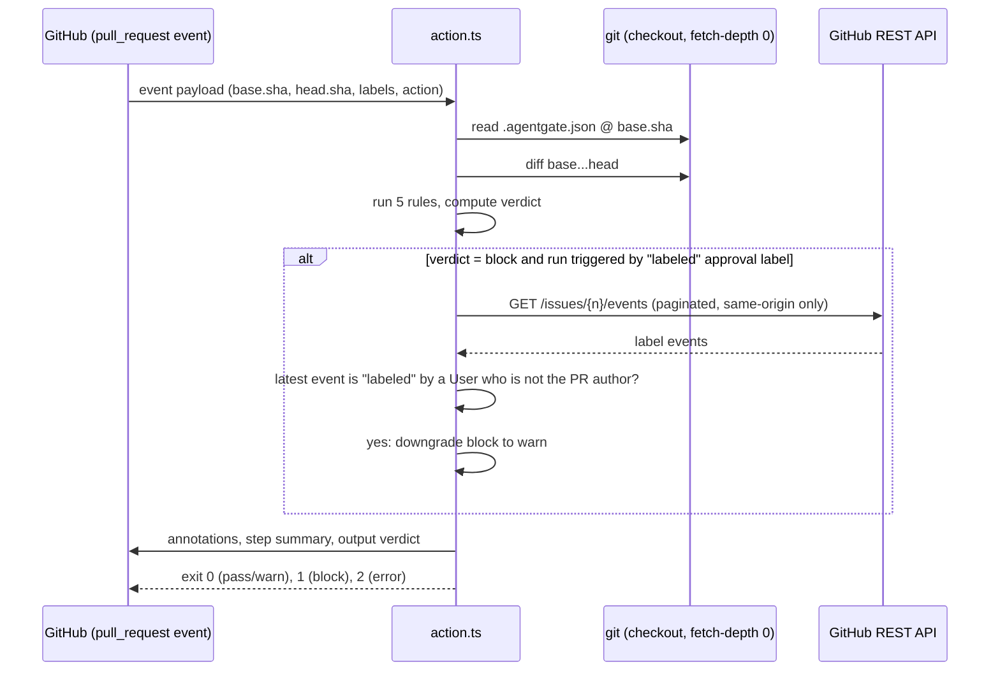
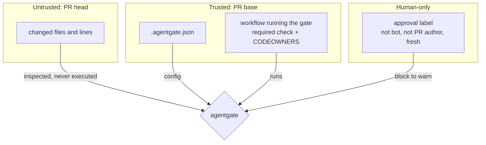

# Architecture

agentgate is a zero-dependency Node 24 program with two entry points sharing one pipeline: a GitHub Action (`src/action.ts`) and a CLI (`src/cli.ts`).

## Components

```mermaid
flowchart LR
  subgraph Entry
    A[action.ts<br/>GitHub Action]
    C[cli.ts<br/>agentgate check]
  end
  subgraph Core
    CO[collect.ts]
    G[git.ts<br/>git diff / show]
    D[diff.ts<br/>hunk parser]
    CF[config.ts<br/>base-commit config]
    E[engine.ts<br/>severity + verdict]
    R[rules/*<br/>5 pure rules]
    RP[report.ts<br/>Markdown / JSON / annotations]
  end
  GH[(GitHub API<br/>issue label events)]

  A --> CO
  C --> CO
  CO --> G --> D
  CO --> CF
  CF -. reads .agentgate.json at base SHA .-> G
  A --> E
  C --> E
  E --> R
  A --> RP
  C --> RP
  A -. override check only .-> GH
```

| Module | Role |
| --- | --- |
| `git.ts` | Runs `git diff base...head` with `--no-ext-diff --no-textconv`, resolves refs, reads blobs. Missing commits raise `GateError` (exit 2). |
| `diff.ts` | Parses unified diffs into added/removed lines per file; flags binary changes. |
| `config.ts` | Loads `.agentgate.json` from the **base** commit. Strict schema; `protectedPaths` is append-only. |
| `rules/*` | Pure functions `(files, ctx) => Finding[]`. No I/O beyond `ctx.readFile`. |
| `engine.ts` | Applies per-rule severity (`block` / `warn` / `off`), computes verdict, downgrades on override. |
| `report.ts` | Renders step summary Markdown, JSON, and escaped workflow annotations. |
| `action.ts` | Reads the event payload, runs the gate, verifies the override label, writes summary and `verdict` output. |

## Request flow (Action)



## Trust boundaries



- The override needs a `labeled` event that is still the newest for that label, applied by a human account other than the PR author. The repository owner may approve their own PR. Any later `synchronize` event blocks again.
- A failed label lookup blocks (fail closed) and the summary says so.

## Exit codes

| Code | Meaning |
| --- | --- |
| 0 | pass or warn |
| 1 | block |
| 2 | usage, config, or environment error (fails closed) |
